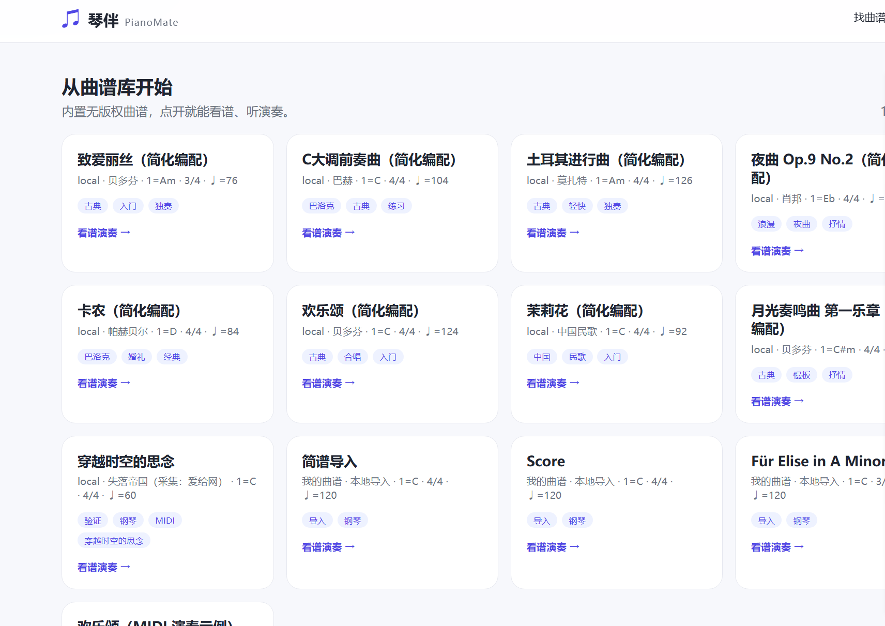
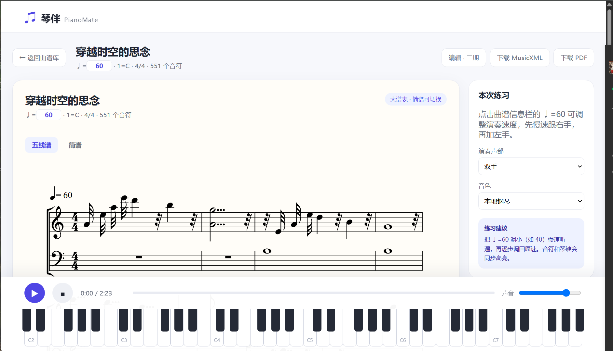
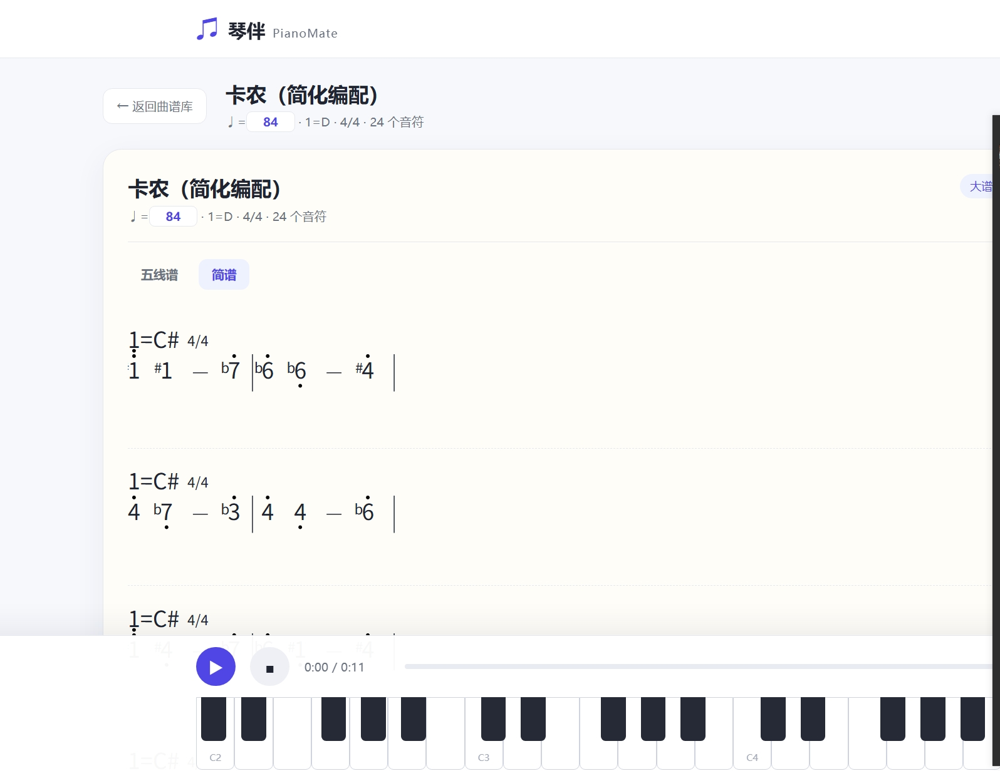
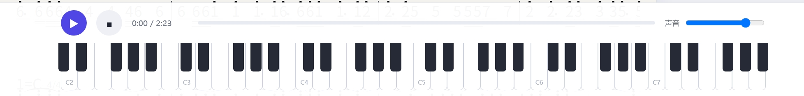

# 琴伴 PianoMate

面向自学钢琴的人：**找到喜欢的曲谱 → 看清完整谱面 → 调速跟弹**。

旧版工具集合已移除，项目只保留新版学习主流程。

## 界面预览

> 截图与演示视频放在 `docs/screenshots/` 和 `docs/videos/`。把素材按下面的文件名放进去，README 会自动展示。

| 曲谱库 | 五线谱跟弹 |
| --- | --- |
|  |  |

| 简谱跟弹 | 演奏控制 |
| --- | --- |
|  |  |

**跟弹演示视频**

<video src="docs/videos/demo.mp4" controls width="720"></video>

（如果视频不自动播放，可[点此下载观看](docs/videos/demo.mp4)。）

## 本期功能

- **找谱**：内置无版权曲谱；支持站外聚合搜索，按来源优先级逐级降级，命中即停止。
- **上传曲谱**：支持 `MusicXML` / `MXL`；图片和 PDF 转谱入口保留，一期不开放。
- **完整看谱**：OSMD 直接渲染原始 MusicXML，支持专业排版与反复记号；失败时回退自绘 SVG。
- **跟着演奏**：Salamander Grand Piano 两层力度采样已本地化，按力度自动切换，本地 WAV 兜底。
- **同步高亮**：OSMD Cursor 跟随播放，简谱和下方琴键同步高亮。
- **唱谱**：按音级唱 `do re mi fa so la si`。
- **下载**：导出 MusicXML 和 PDF。
- **编辑扩展**：本期不做在线打谱；曲谱数据模型和本地曲谱库已保留后续扩展点。

## 安装与启动

```powershell
.\.venv-omr\Scripts\python.exe -m pip install -r requirements.txt
.\.venv-omr\Scripts\python.exe run.py
```

浏览器打开 <http://127.0.0.1:8000>。

服务必须使用项目内的 Python 3.11 环境：`.venv-omr\Scripts\python.exe`。

## 曲谱来源

内置曲谱位于 `bapu/scores/`，均为公有领域曲目的简化编配。用户导入的曲谱保存到 `bapu/scores/user/`。

聚合来源默认顺序：

```text
local,openscore,mutopia,imslp,musopen,pianomidi,custom
```

搜索规则：当前来源有结果就停止；搜不到才自动降级到下一个来源。

## 当前接口

```text
GET  /api/health
GET  /api/scores
GET  /api/scores/{key}
POST /api/scores/import
GET  /api/search
GET  /api/score/{id}/musicxml
GET  /api/score/{id}/pdf
```

旧版 `/legacy` 和旧工具接口已删除。

## 后续迭代

- 开放图片 / PDF 转谱入口；
- 在线打谱与编辑；
- 更精细的分声部练习、循环片段和指法提示。

## 测试

```powershell
.\.venv-omr\Scripts\python.exe -m unittest discover -s tests -v
```
